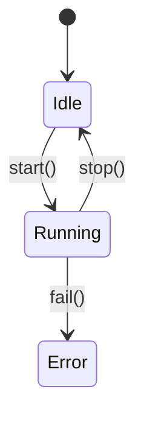

# Scholar

Unified long-form writing skill. Combines `reflection-writer`, `reflexiones-writer`, and `research-scribe` under a single entry point with an explicit destination decision before any prose is drafted.

---

## Step 0 — Decision Point (always runs first)

Before doing anything else, determine the output surface. Infer it from context; only ask if genuinely ambiguous.

**If the destination is unambiguous** (user said "para Reflexiones", pasted BibTeX, said "nota de literatura") → infer silently and proceed.

**If the destination is ambiguous** → ask once, concisely:

> ¿Dónde quieres escribir?
> 1. **Reflexiones_a_Latex** — fragmento LaTeX compilable + companion markdown, integrado en el corpus existente
> 2. **OmarOS vault** — nota markdown en `06_Knowledge_Base/` o `04_Research/`
> 3. **Buscar primero en la web** — investigo el tema online y luego escribo en vault o Reflexiones

Route:

| Signal in user's message | Route |
|---|---|
| "para Reflexiones", "para el documento", "al nivel del documento", "integra con el corpus", "expande el capítulo de", "añade sección a Reflexiones" | → **L** (LaTeX) |
| "nota de literatura", "anota este paper", "literatura", BibTeX/DOI pasted, "derive", "open question", "bench-book", "research log" | → **R** (Research artefact) |
| "busca", "investiga", "search", "look up", "find sources" | → **W** (Web first) |
| Everything else (reflexión, ensayo, escribe sobre X, desarrolla, formaliza, escribe que…) | → **V** (Vault essay) |

---

## Route V — Vault Essay

**Destination:** `06_Knowledge_Base/<subdomain>/<area>/<slug>.md` by default. Only route to `01_Daily_Life/Reflections/` (personal/diary register, explicitly requested) or `04_Research/Essays/` (single-thread derivation tied to open research, explicitly requested).

Three-level path is mandatory for `06_Knowledge_Base` — never place a file in the subdomain root.

| Subdomain | Area examples |
|---|---|
| `Mathematics` | `Algebra/`, `Analysis/`, `Topology/`, `Measure_Theory/`, `Probability_and_Statistics/`, `Differential_Equations/` |
| `Computing` | `Concurrency/`, `Type_Systems/`, `Languages/`, `Algorithms_and_Data_Structures/`, `Machine_Learning/` |
| `Physics` | `Classical_Mechanics/`, `Quantum_Mechanics/`, `Statistical_Mechanics/`, `Field_Theory/` |
| `Philosophy` | `Epistemology/`, `Logic/`, `Ethics/`, `Philosophy_of_Science/` |
| `Economics` | `Microeconomics/`, `Finance/`, `Econometrics/` |

**Calibration exemplar:** `06_Knowledge_Base/Computing/Concurrency/python_asyncio.md` is the master reference document. Every technical note is calibrated against it. The defining features of that document are: layered structure (human analogy → technical formalism), conceptual preambles before every dense section, inline English term definitions at first use, ASCII diagrams with captions, Four Movements structure, and notes written to the length of a manual. Read it before writing any computing note. Key sections for study: §§I.10, II.0, III.0, VI.0, VIII.0, XI.0, XII.0, XVI.0 for the `§X.0` preamble pattern; §§I.1–I.2 for inline jargon definitions; §§V.1–V.3 for the transition from conceptual to technical.

**Procedure:**

1. Classify input (raw material or directive; personal or technical register; identify the single load-bearing claim). If ambiguous, ask one focused question.
2. Reorder disordered input: extract every claim/definition/example into a flat list → mark prerequisites → topological sort → group into Four Movements. Never preserve original order out of fidelity. (See §REF-REORDER below.)
3. Pick destination (see table above; default is `06_Knowledge_Base`).
4. Draft Movement I first (ambient category → minimal definitions → load-bearing claim). (See §REF-FOUR-MOVEMENTS below.)
5. Draft Movements II → III → IV using the essay template. (See §REF-ESSAY-TEMPLATE below.)
6. Self-containment pass: every technical term defined inline or anchored. (See §REF-SELF-CONTAINMENT below.)
6a. **Conceptual preamble pass** (mandatory for technical notes with multiple dense subsections): For each section heading that introduces technically demanding content, prepend a `§X.0` subsection titled "Antes de la implementación: …" / "Antes del algoritmo: …" / "Antes de las reglas: …" (adapt as appropriate). The `§X.0` must: (a) state in plain terms what problem the section solves, (b) provide at least one concrete analogy or metaphor that requires no prior technical knowledge, (c) contain no code and no unexplained jargon, (d) include an ASCII diagram if the concept is spatial, temporal, or hierarchical. The technical treatment follows in §X.1+. The reader should be able to understand what is about to happen before it happens.
6b. **English jargon pass** (mandatory for all technical notes): every English technical term, design-pattern name, or acronym that appears in the note must be defined at its first occurrence, inline in parentheses, in the form `*term* (Spanish equivalent — brief explanation of its role in this context)`. This applies even to terms the reader probably knows — the definition anchors its precise role in this document. Non-exhaustive list of terms that always require definition: `placeholder`, `scheduler`, `driver`, `handle`, `backpressure`, `garbage collector`, `monkey-patch`, `fast path`, `fire-and-forget`, `RAII`, `RTT`, `throughput`, `DAG`, `scope`, `lifecycle`, `entry point`, `ownership`, `fairness`, `syntactic sugar`, `overhead`, `eager/lazy`, `GIL`, `callback`, `hook`, `wrapper`, `polymorphic dispatch`, `trait`, `mixin`.
7. Visual aids pass (mandatory for technical notes): add ASCII/Mermaid/table wherever content has spatial, temporal, hierarchical, or relational structure. Every diagram has an italic caption. (See §REF-VISUAL-DISCIPLINE below.)
8. Conceptual-honesty pass: no conflated object/representation, no smuggled coordinate-dependence, no tacit assumptions.
9. Frontmatter: `latex_pending: true` for `04_Research/` and `06_Knowledge_Base/` notes. Language of output = language of prompt.

---

## Route L — LaTeX / Reflexiones_a_Latex

**Corpus root:** `/Users/omarkhalil/Desktop/Universidad/Reflexiones_a_Latex/`

**Output:** `.tex` fragment (compile-clean) + markdown companion in `04_Research/Essays/<Area>/<slug>.md`.

| User intent | Action |
|---|---|
| "añade una sección sobre X" | new `chapters/<Area>/<slug>.tex` + companion |
| "expande el capítulo de Y" | append section inside `chapters/<Area>/<area>.tex` |
| "integra esto con lo que ya hay sobre Z" | consult corpus, extend existing treatment |

**Procedure:**

1. Identify the canonical area folder under `chapters/` using the map in §REF-CORPUS-NAVIGATION below.
2. **Corpus consultation (mandatory, blocking):** grep the target chapter + adjacent chapters for the main terms. Record: existing labels, notation, bib entries, prior treatments.
3. Draft in Four Movements (LaTeX-adapted): Movement I = unnumbered intro prose; II = `\begin{definition}` environments; III = theorems/propositions/proofs; IV = closing + `\ref{}` + `\cite{}`.
4. Write `.tex` fragment using only environments from the master preamble. Label convention: `prefix:slug` (e.g. `def:weak_derivative`, `thm:lln_kolmogorov`). Use the section template in §REF-SECTION-TEMPLATE below.
5. **Bibliography-before-citation:** every `\cite{key}` must reference an existing `Libreria.bib` entry. If missing, add the bib entry first.
6. Write markdown companion at `04_Research/Essays/<Area>/<slug>.md`: same Four Movements in MathJax, frontmatter with `latex_pending: false`, `latex_source: <relative path>`, `latex_labels: [...]`.
7. Verify: compile-clean (`lualatex --draftmode`), `\ref{}` resolution, label uniqueness, notation consistency, companion parity.

---

## Route R — Research Artefact

**Destinations:**

| User intent | Path |
|---|---|
| Literature note ("add lit note on <AuthorYear>", paste BibTeX/DOI) | `04_Research/Literature/<AuthorYear>_<slug>.md` |
| Derivation ("derive X", "write up this proof") | `04_Research/Derivations/<slug>.md` |
| Research log / bench-book | `04_Research/Logs/YYYY-MM-DD_<slug>.md` |
| Open question | `04_Research/Open_Questions/<slug>.md` |
| Resolve open question | Update that file's frontmatter + append resolution paragraph |

**Procedure:**

1. Classify: literature / derivation / log / open_question. Resolve slug.
2. **Prior-art pass (mandatory, blocking):** grep the Reflexiones_a_Latex corpus for the topic. If coverage is substantial, ask whether to extend, complement, or expand-import. (See §REF-PRIOR-ART below.)
3. Write the artefact at the omniscient-scholar standard with three-layer definitions (fundamental → rigorous intuition → personal vision). At least one cross-domain connection per major concept.
   - **Literature note sections:** Bibliographic context → Core claims → Method → Three-layer reading → Cross-domain connections → Critical remarks → Next actions → References.
   - **Derivation sections:** Statement → Prerequisites → Layer 1 claim → Layer 2 rigorous intuition → Proof → Layer 3 personal vision → Example → Counterexample/boundary → Cross-domain connections → References.
4. Cross-link: literature → `06_Knowledge_Base/MOCs/Research_MOC.md`; derivation → `04_Research/Theorems/`; log → every paper/derivation/question it references; open question → Research MOC under `## Open questions`.
5. `latex_pending: true` on all `04_Research/` notes.

---

## Route W — Web First

1. Search the web for the topic using available tools.
2. Synthesize findings.
3. Ask: "¿Escribo esto en el vault (markdown) o en Reflexiones (LaTeX)?" → route to V or L accordingly.

---

## Style

### Register selection (infer from note type; do not ask)

| Note type | Register | Voice | Math policy | Cross-domain | Length |
|---|---|---|---|:---:|---|
| theorem / proof / definition | `omniscient_scholar` | neutral | `rigorous_three_layer` | ✓ | long |
| derivation | `omniscient_scholar` | first-person | `rigorous_three_layer` | ✓ | long |
| evergreen (KB, research) | `omniscient_scholar` | neutral | `rigorous_three_layer` | ✓ | long |
| research log / paper note | `technical` | first-person | `rigorous` | ✗ | medium |
| conjecture / open question | `omniscient_scholar` | first-person | `rigorous` | ✓ | medium |
| personal reflection / essay | `reflective` | first-person | `off` | ✗ | long |

**`omniscient_scholar`** — mandatory for `04_Research/` and `06_Knowledge_Base/` math content. Voice of Serre, Atiyah, Gowers, Milnor: technically impeccable, humanly engaged. Always `rigorous_three_layer`; always cross-domain synthesis.

**`reflective`** — essayistic, not bulleted. First-person paragraphs. LaTeX for formulas even inside markdown. Open questions are genuine questions.

**`technical`** — formal, precise. LaTeX for all mathematics. No decorative elements.

### Math policy: `rigorous_three_layer` (mandatory for `omniscient_scholar`)

Every non-trivial definition at three layers:

1. **Fundamental Definition** — most abstract, categorical, minimal-structure form. Self-contained.
2. **Rigorous Intuition** — why this is the right definition; what fails if you weaken each condition; compressed proofs.
3. **Personal Intellectual Vision** — what does this concept reveal about the structure of mathematics, physics, or computation?

A concrete example is mandatory after every abstract definition.

### Cross-domain synthesis routes (apply whenever `cross_domain_synthesis: true`)

Surface at least one "same structure, different domain" observation per major definition. Canonical routes:

- Finance ↔ stochastic calculus ↔ measure theory ↔ functional analysis
- Numerical methods ↔ functional analysis ↔ variational principles ↔ physics (PDEs, Lagrangian mechanics)
- Category theory ↔ type theory ↔ logic ↔ geometry
- Physics ↔ differential geometry ↔ variational calculus ↔ mechanics
- Probability ↔ measure theory ↔ ergodic theory ↔ statistical mechanics
- Spacetime ↔ smooth manifolds ↔ fibre bundles ↔ gauge theory

### Guardrails (all routes)

`no_ai_attribution` · `no_cheerleading` · `no_decorative_comments` · `no_trailing_summary` · `definitions_before_use` · `examples_after_definitions`

---

## Shared Discipline

All routes inherit:

- **Four Movements:** Orientation → Terrain → Substantive → Synthesis. Movement I is never skipped. Full spec: §REF-FOUR-MOVEMENTS.
- **Style canon:** forbidden phrasings, omniscient-scholar voice. Full spec: §REF-STYLE-CANON.
- **Mathematical register:** notation, proof/sketch/pointer, layering. Full spec: §REF-MATH-REGISTER.
- **Manual length:** notes are manuals, not summaries. Technical subjects typically demand 1500–3000+ lines. Full spec: §REF-MANUAL-LENGTH.
- **Language policy:** output language = language of the user's prompt.
- **Layered exposition (non-negotiable):** every technically dense concept is presented in two passes. Pass 1 — the conceptual preamble (`§X.0`): analogy, metaphor, problem statement, what the reader needs to understand *before* the formalism hits them. Pass 2 — the technical section (`§X.1+`): formal definitions, code, derivations. The preamble is not remedial content for beginners; it is the correct epistemic order — mental model before symbol manipulation. Do not skip the preamble even when the reader is expert.
- **Jargon transparency (non-negotiable):** every English technical term, design-pattern name, or acronym is defined at first use, inline, in parentheses, even if the reader probably knows it. Format: `*term* (translation — explanation of its precise role here)`.

---

---

# §REF-FOUR-MOVEMENTS — The Four Movements: structural template

Every note produced by this skill follows the same four-movement structure. It is the document-level encoding of the *object-before-comparison* discipline. The structure is not flexible; its contents are.

---

## Movement I — Orientation

**Purpose.** Tell the reader what class of objects we are in, what the specific objects are, and what question or claim the note is about.

**Length.** One to three paragraphs. Never longer. Never skipped.

**Must contain, in this order:**

1. **The ambient category.** The *class* the objects belong to. (*"JSON and YAML are representation systems for finite labelled trees."* / *"A hedge is a functional approximation applied to a map from market states to portfolio value."*)
2. **Minimal definitions of the objects in play.** One sentence each, enough to anchor the noun. Full definitions live in Movement II.
3. **The claim or question.** The single load-bearing sentence the rest of the note will justify or refine.

**Failure modes.**

- Starting with a comparison *before* the category is named. This is the default failure and the one we are explicitly correcting.
- Starting with history, motivation, or a hook. Strip these; they belong in an afterword, if anywhere.
- Stating the claim so vaguely that the reader cannot tell what the note will establish.

**Example — the opening of a note on JSON vs YAML:**

> JSON and YAML are both syntactic systems for representing the same mathematical object: finite labelled trees with scalar, sequence, and mapping nodes. JSON is the canonical, rigid, machine-oriented encoding; YAML is the expressive, human-oriented encoding that includes JSON as a proper subset. This note establishes the precise sense in which the two encode the same structures while differing in determinism, ambiguity, and operational role, and catalogues the full set of syntactic constructs each accepts.

Three sentences. Category → objects → claim. Movement I complete.

---

## Movement II — Terrain

**Purpose.** Lay out the formal and structural landscape. Define every load-bearing term. Introduce the formalism that will carry the analysis.

**Typical contents.**

- Formal definitions of the objects introduced in Movement I.
- The ambient mathematical structure (space, category, algebra, graph, language, …).
- Primitive constructors and composition rules.
- Invariants, equivalences, admissible transformations.
- Tables of correspondences.
- Enumerated properties.

**Rule of thumb.** A reader who reads only Movements I and II should already possess the landscape, even if they stop there. Movement II is the skeleton; Movement III is the muscle.

**Worked mini-example.** For a note on *measurable functions*:

> A **measurable space** is a pair $(X, \Sigma)$ where $\Sigma \subseteq 2^X$ is a $\sigma$-algebra on $X$ — a collection closed under countable unions, intersections, and complements. A **measurable function** $f : (X, \Sigma_X) \to (Y, \Sigma_Y)$ is a map such that $f^{-1}(B) \in \Sigma_X$ for every $B \in \Sigma_Y$. Equivalently, the preimage map $f^{-1} : \Sigma_Y \to \Sigma_X$ is a morphism of $\sigma$-algebras. Two structural observations are load-bearing for what follows. First, measurability is a property of the pair $(f, \Sigma_X, \Sigma_Y)$, not of $f$ alone; the same set-function can be measurable under one pair of $\sigma$-algebras and not under another. Second, the composition of measurable functions is measurable, so measurable spaces form a category with measurable functions as morphisms.

Notice the pattern: definition, alternative formulation, structural observation, categorial placement. Four moves in one paragraph.

---

## Movement III — The Substantive Content

**Purpose.** Do the actual work. Answer the question. Draw the distinction. Prove the claim. Perform the comparison. Exhibit the example.

**Shape depends on note type.**

| Note type | Movement III contains |
|---|---|
| Comparative | The comparison proper, tables, formal relations ($\subset$, $\cong$, …), shared structure, divergence points, calibration examples. |
| Derivation | Steps, each with justification or sketch; clear markers between rigorous and heuristic. |
| Synthesis | The unifying abstraction, the specialisations that fall out, the new perspective it affords. |
| Philosophical reflection | The argument, with distinctions drawn explicitly (object/representation, syntax/semantics, …). |
| Exposition | The careful walk-through, with worked examples, counterexamples, and edge cases. |

**Rules that apply to all shapes.**

- Every non-trivial claim is either proved, sketched, or pointed to a reference.
- Every formal symbol introduced has been defined in Movement II or is defined on first use.
- Examples earn their place by forcing a distinction, not by illustrating.

---

## Movement IV — Synthesis and Outward Connections

**Purpose.** Close the note with the refined claim, the outward connections, and the honesty note.

**Must contain.**

1. **The precise formulation.** One or two sentences stating, as cleanly as possible, the claim the note has established. This is the sentence the user will reread in six months and understand instantly.
2. **Outward connections.** Wikilinks or named references to topics where the same structure, the same failure mode, or the same distinction appears. No hand-waves; only connections that survive the *"would an expert say yes?"* test.
3. **Honesty note.** What has been assumed? What has been left unformalised? What is the next object of study if this thread is pulled further?

A note without Movement IV is a draft, not a note. The synthesis is the reason the note is a durable artefact rather than a conversation.

---

## A full worked skeleton

Here is the canonical skeleton of a note on a topic $T$, applied to a comparison of objects $A$ and $B$:

> **I. Orientation.** *[Category $\mathcal{C}$ that contains both $A$ and $B$.] [One-sentence $A$.] [One-sentence $B$.] [The load-bearing claim about their relation.]*
>
> **II. Terrain.** *[Full definition of $A$.] [Full definition of $B$.] [The ambient structure $\mathcal{C}$ in detail.] [Table of corresponding primitives.] [Inclusion or relation between them as subclasses of $\mathcal{C}$.]*
>
> **III. The substantive content.** *[The comparison along the load-bearing axes.] [Calibration examples.] [The formal relation.] [Cases where the distinction matters operationally.]*
>
> **IV. Synthesis.** *[Refined claim.] [Connections to $D_1, D_2, \dots$.] [Assumptions / limitations / next objects.]*

---

## Nested structure within a Movement

Each Movement is a container, not a flat section. When a Movement carries multiple load-bearing components, subdivide with `### I.1`, `### I.2`, `### II.1`, `### II.2`, etc. The numbering is fractal: `I`, `I.1`, `I.1.a` are all legitimate levels when the content warrants them.

**When to subdivide:**

- Movement I has multiple prerequisite definitions that each deserve their own anchor.
- Movement II has a formal core and a structural/illustrative core that should not be mixed (e.g. `II.1 Definiciones formales`, `II.2 Taxonomía`, `II.3 Correspondencias`).
- Movement III has multiple axes of analysis, each meriting its own subsection (`III.1 Memoria`, `III.2 Polimorfismo`, `III.3 Genéricos`).

**When not to subdivide:** a single-paragraph Movement needs no heading beyond the roman numeral. Subdivision is a response to content volume, never a decorative move.

---

## The most common failure

By far: starting with the comparison before naming the category. The symptom is a note that opens with *"JSON is strict; YAML is flexible"* and only later — if at all — tells the reader that both are syntactic encodings of the same object. The reader is left to reverse-engineer the category from the comparison. This is backwards.

**The corrective** is mechanical: **always write Movement I first, in full, before anything else**. Even if the user's prompt starts mid-comparison, write the orientation first, then continue.

---

---

# §REF-ESSAY-TEMPLATE — Essay template (markdown)

```markdown
---
title: "{{title}}"
status: active
note_type: essay
domain: 04_Research
subdomain: Essays
area: {{area}}
tags: [essay, {{area}}]
created: {{date}}
updated: {{date}}
author: Omar
ai_generated: true
ai_reviewed: false
confidence: high
latex_pending: true
---

# {{title}}

> *[Thesis block of 1–4 sentences, in italics inside a blockquote. Compress: (i) the load-bearing claim, (ii) the method / scope of the note, (iii) explicit prerequisites or supposed context. This is the paragraph the reader rereads in six months to recover the entire note.]*

---

## I. Orientation

*[Name the ambient category / class the objects belong to. Give a minimal one-sentence characterisation of each object in play. State the precise question or claim the essay addresses. Subdivide as ### I.1, ### I.2, ### I.3 when the orientation itself has multiple load-bearing components (e.g. formal definition → illustrative counterexample → placement in a taxonomy).]*

---

## II. Terrain

### Definitions

*[Full formal definitions of the load-bearing objects. Layer 1 for standard terms; Layer 2 for terms that carry proofs or derivations; Layer 3 only where the abstract view illuminates.]*

### Structure

*[The ambient structure — category, space, algebra, language. Primitives, composition rules, invariants, equivalences.]*

### Correspondences

*[Tables, typings, or formal correspondences between the objects. If there is a proper inclusion or isomorphism between them, state it formally.]*

---

## III. The Substantive Content

*[The actual work of the essay. Structure adapted to purpose: comparison, derivation, synthesis, exposition. Every non-trivial claim is either proved, sketched with its label, or pointed to a reference. Examples earn their place by forcing a distinction.]*

---

## IV. Synthesis

### The precise formulation

*[One to two sentences stating the refined claim the essay has established.]*

### Connections

- *[Wikilink to adjacent domain 1 — what the shared structure is.]*
- *[Wikilink 2.]*

### Limitations and next objects

*[What has been assumed. What has been left unformalised. What is the next object of study if this thread is pulled further.]*

---

## References

- *[Named reference with anchor if the claim depends on it.]*
- *[External reference with URL or citation.]*
```

---

---

# §REF-SELF-CONTAINMENT — Definitional discipline

A note produced by this skill is an island. The user will consult it in six months without the surrounding vault open. Every term the note depends on must be defined inside the note — or, exceptionally, via a named pointer to a specific prior note.

---

## The three layers of definition

### Layer 1 — intuition

A short informal characterisation that anchors the word. One or two sentences. No formalism.

> *A measure is a way of assigning sizes to subsets in a consistent manner.*

Layer 1 is always given for any term the reader could plausibly not have active in working memory.

### Layer 2 — formal

The standard formal definition. Symbols, types, axioms.

> *A measure on a measurable space $(X, \Sigma)$ is a function $\mu : \Sigma \to [0, \infty]$ satisfying $\mu(\emptyset) = 0$ and countable additivity: $\mu(\bigsqcup_i A_i) = \sum_i \mu(A_i)$ for any disjoint countable family $\{A_i\} \subseteq \Sigma$.*

Layer 2 is given whenever a term appears in a proof, a derivation, or any claim the note establishes formally.

### Layer 3 — abstract / structural

The categorial, topological, or structural view that places the term inside a larger abstraction.

> *Measures are the morphisms in the Kleisli category of the Giry monad; $\mathrm{Meas}$ has measurable spaces as objects and measurable maps as morphisms, and $G X = \{$measures on $X\}$ gives a probabilistic extension of that category.*

Layer 3 is given **only** when the abstract view genuinely clarifies what follows. Never for ornament.

---

## The decision procedure

For each technical term $t$ the note uses:

1. **Is $t$ a standard term whose intuitive meaning a mathematically mature reader already holds?** (*metric*, *compact*, *continuous*, *derivative*, *group*.) If yes, no definition needed unless the note uses $t$ in a way that depends on a specific formal property.
2. **Is $t$ load-bearing for the argument of the note?** If yes, give at least Layer 1. Upgrade to Layer 2 if the argument uses properties not recoverable from the intuition.
3. **Does the note's main claim or synthesis use $t$ in its abstract structural form?** If yes, give Layer 3.
4. **Is $t$ used in a specialised sense specific to this note or to OmarOS?** If yes, say so explicitly: *"In this note, we use $t$ to mean…"*.

The working rule: **minimum layer that makes the note correct and unambiguous in isolation.**

---

## The first-use rule

A term is defined on **first use**, not at the end, not in a glossary, not in a footnote. The reader encounters the term and, in the same paragraph or the next one, finds its definition.

---

## The self-containment pass

Before declaring a draft finished, run this pass explicitly:

1. Extract every technical noun that appears in the note.
2. For each, locate where it is defined (or pointed to).
3. For any that are used without definition, either define them inline or remove the usage.
4. For the load-bearing terms, check whether Layer 1 suffices or Layer 2 is needed.
5. For any Layer-3 definition, check that it genuinely illuminates; cut if ornamental.

This pass typically adds 10–20% to the note's length. That length is load-bearing: it is the price of durability.

---

---

# §REF-VISUAL-DISCIPLINE — Diagrams, figures, and ASCII art

Every technical note **must** include visual aids wherever a diagram, table, or schematic clarifies more than prose. Diagrams are not ornamental; they are load-bearing when the concept has spatial, temporal, hierarchical, or relational structure.

## When a diagram is mandatory

Add a diagram whenever the content contains any of:

- **Sequential execution / timeline** — call stack evolution, event loop iterations, message passing between processes. Use a timeline or swimlane diagram.
- **Hierarchies / lattices** — class inheritance, type subsumption, domain decomposition. Use a tree or Hasse diagram.
- **State machines** — lifecycle, protocol, mode transitions. Use a state-transition diagram with labelled edges.
- **Data flow / pipelines** — transformations, ingestion, routing. Use a boxes-and-arrows flow diagram.
- **Layered architectures** — software stacks, memory models, network layers. Use a stacked-boxes diagram.
- **Categorical / algebraic structure** — functors, monads, morphisms. Use a commutative diagram.
- **Comparison across N systems** — feature matrix, correspondence table. Use a table (tables count as visual aids).
- **Memory / storage layout** — heap vs stack, struct layout, tree representations. Use a boxed memory diagram.

## Preferred formats (in order)

1. **ASCII / Unicode box diagrams** directly in the markdown code fences. These render everywhere, never break, and survive decades. Default choice.
2. **Mermaid diagrams** inside ` ```mermaid ` fences — for flowcharts, sequence diagrams, state diagrams, class diagrams. Obsidian and GitHub render these natively.
3. **Markdown tables** — always in play as lightweight structured visual aids.

Do NOT embed binary images unless the user explicitly asks.

## Quality bar

A good diagram:

- Has a **caption** naming what it shows (one line, italicised, below the figure).
- Labels every node, arrow, and region that the prose refers to.
- Is referenced from the surrounding prose at least once.
- Uses consistent symbols across the note.
- Fits the ambient category.

A bad diagram is decorative: a flowchart that restates the section headings, an ASCII box around a single word. If a diagram adds no information the prose does not already give, delete it.

## ASCII diagram conventions

- Use `┌─┐ │ └─┘` box-drawing characters for boxes. Plain `+---+ | +---+` is acceptable if the ambient text is ASCII-only.
- Arrows: `──▶` for flow, `◀──▶` for bidirectional, `─┬─` for branch.
- Time flows left-to-right or top-to-bottom — pick one per diagram and stay consistent.
- Align columns with spaces, not tabs.

## Mermaid quick reference



```mermaid
sequenceDiagram
    Caller->>Loop: asyncio.run(coro)
    Loop->>Coro: send(None)
    Coro-->>Loop: yield Future
    Loop->>Selector: select()
```

## The rule

**When in doubt, draw.** The cost of a redundant diagram is small; the cost of a concept the reader cannot spatialise is large. If the concept has shape, show the shape.

---

---

# §REF-STYLE-CANON — Style canon: the six principles, operationalised

The six principles below are operational constraints. A note that violates any of them is a draft, not a finished note.

---

## I. The writing must be extraordinary

**Demands.** Every note must sound like the work of an unusually deep thinker — one capable of moving naturally between concrete instance and high abstraction, and of connecting local facts to global structures. The reader should feel that the note was written by someone who has *understood*, not merely *researched*.

**Forbids.** Generic prose. Textbook filler. Blog-style openings. Anything that sounds like the output of a model optimising for helpfulness rather than depth.

**Calibration.**

- ❌ *"In this article, we will explore the fascinating relationship between hedging strategies and differential calculus."*
- ✅ *"A hedge is, in the simplest reading, the first-order approximation of a function of risk — a Taylor expansion truncated at the linear term. Everything that follows refines this statement or qualifies the conditions under which it holds."*

---

## II. Abstraction must be sought proactively

**Demands.** For every topic, name the most general structural layer at which the topic lives coherently. Ask — and answer, explicitly when useful: what is the object? what is its ambient structure? what are its admissible transformations? what equivalences matter? what is representation and what is essence? what is syntax and what is semantics?

**Forbids.** Treating concrete cases as if they were the content. Hiding the abstract structure behind a worked example without naming it.

**Calibration.**

- ❌ *"A vector is a list of numbers."*
- ✅ *"A vector is an element of a vector space — an object whose structure is defined by the axioms of the vector space, not by any particular representation as a tuple. Coordinates are a representation; the vector is not its coordinates."*

---

## III. Unification by default

**Demands.** When an adjacent domain offers a genuinely illuminating connection, make it. A note about algorithms should reach for the theory of functions, relations, morphisms, dynamical systems, or realisability when any of these sharpens the exposition.

**Forbids.** Forced connections. If an analogy does not sharpen the point, it is ornament, and ornament is banned.

**Heuristic test.** Could an expert reader legitimately say *"yes, that is how I think about it too, and it clarifies X"?* If yes, the connection belongs in the note.

---

## IV. Conceptual honesty

**Demands.** Distinguish, explicitly whenever it matters:

| Distinction | Typical failure if flattened |
|---|---|
| Object / representation | Confusing coordinates with the vector. |
| Intrinsic / coordinate-dependent | Claiming a basis-dependent result is geometric. |
| Syntax / semantics | Equating a formula with what it denotes. |
| Rigorous / heuristic | Calling a plausibility argument a proof. |
| Ontological / epistemic | Claiming something *is* X when all you know is it *behaves like* X. |
| Local / global | Extending a pointwise fact to a uniform one. |
| Formal / implementation | Conflating a model with its numerical scheme. |

**Forbids.** Smuggling in an unstated assumption. Asserting more than has been shown. Collapsing a subtle distinction because it is rhetorically inconvenient.

---

## V. Elegant but not pompous

**Demands.** Density of thought per sentence. Precision of term. Rhythm that carries the reader without fatiguing them.

**The forbidden-phrase list** (banned on sight):

- *"In this article/note we will…"* — start with the claim, not the promise.
- *"Let us embark on…"* / *"Let us explore…"*
- *"It is fascinating to note that…"* — if it is fascinating, show why; do not label it.
- *"In the vast landscape of…"*
- *"At the core of X lies Y."* — usually vague; be specific.
- *"A deep dive into…"*
- *"Unpacking the nuances of…"*
- *"It is worth mentioning that…"* — if it is worth mentioning, mention it without the hedge.
- *"As we shall see…"* — write it, do not announce it.

---

## VI. Rigour without sterility

**Demands.** Formalism where it illuminates, prose where it carries, examples where they anchor, diagrams where they compress.

**Forbids.** Pure symbol-pushing without interpretation. Empty formalism ("let $X$ be a thing") that does no work. Pseudo-rigour — invoking theorems whose hypotheses are not checked.

---

## On the specific reader

The reader is Omar: mathematically mature, cross-trained in physics and computation, allergic to superficial summaries, attentive to structure. Write *for him*. Assume he knows what a group is, what a metric space is, what a morphism is. Do not redefine the basics; do define the load-bearing specifics, because he will consult the note in six months without the surrounding context.

The cadence he prefers: **definition → structure → result → connection → limitation**. Not *motivation → history → definition → worked example → summary*.

---

## Final test — the one-question audit

Before declaring a note finished, ask:

> *If I showed this note to a senior mathematician who knew the subject, would they read it with respect, or would they be polite?*

If the answer is "respect", the note is done. If it is "polite", rewrite.

---

---

# §REF-MATH-REGISTER — Mathematical register: notation, formalism, proofs

---

## When to formalise

Formalism is a tool, not a decoration. Introduce a formal object when one of the following holds:

1. **It sharpens a distinction** the prose cannot make cleanly.
2. **It supports a claim** that would otherwise be a hand-wave.
3. **It enables a derivation.**
4. **It compresses** — a diagram or a commuting square can replace three paragraphs of prose.

Do **not** introduce formalism when:

1. The prose already carries the content unambiguously.
2. The symbol is introduced and never re-used.
3. The formalism is ornamental.

---

## Notation conventions

### Sets and spaces

- Generic sets: $X, Y, Z$. Subsets: $A, B \subseteq X$.
- Elements: $x \in X$. Families: $\{x_i\}_{i \in I}$.
- Common spaces: $\mathbb{N}, \mathbb{Z}, \mathbb{Q}, \mathbb{R}, \mathbb{C}$.
- Function spaces: $C(X), L^p(X, \mu), \mathcal{H}$ for a Hilbert space.

### Functions and maps

- Definition: $f : X \to Y$.
- Action on element: $f(x)$ or $x \mapsto f(x)$ when emphasising the rule.
- Composition: $g \circ f$.
- Preimage: $f^{-1}(B)$. Inverse, if $f$ is invertible: also $f^{-1}$, but say so.
- Partial functions: $f : X \rightharpoonup Y$ (half-arrow).

### Categories and morphisms

- Category: $\mathcal{C}, \mathcal{D}$. Objects: $\mathrm{Ob}(\mathcal{C})$. Morphisms: $\mathrm{Hom}_{\mathcal{C}}(A, B)$ or $\mathcal{C}(A, B)$.
- Functor: $F : \mathcal{C} \to \mathcal{D}$.
- Natural transformation: $\eta : F \Rightarrow G$.
- Use categorial language only when it is doing work.

### Measure and probability

- Measurable space: $(X, \Sigma)$. Measure: $\mu : \Sigma \to [0, \infty]$.
- Probability space: $(\Omega, \mathcal{F}, \mathbb{P})$. Random variable: $X : \Omega \to \mathbb{R}$, measurable.
- Expectation: $\mathbb{E}[X]$. Conditional: $\mathbb{E}[X \mid \mathcal{G}]$.

### Logic and quantifiers

- $\forall$, $\exists$, $\implies$, $\iff$, $\neg$, $\wedge$, $\vee$.
- Prefer prose over symbols in connecting sentences; reserve symbols for formal statements.

### Typography

- Inline math: `$...$`. Display math: `$$...$$` on its own paragraph.
- Bold for defined terms on first use: **measurable space**.
- `\mathcal{...}` for categories and distinguished spaces.
- `\mathbb{...}` for number sets and canonical spaces.
- `\mathfrak{...}` for $\sigma$-algebras, Lie algebras, ideals — when the convention is standard.

---

## Proofs and sketches

Three permitted modes. Label each.

### Full proof

Only when the result is load-bearing for the note and the proof fits in one screen:

> **Proposition.** *Statement.*
>
> *Proof.* Step 1: … Step 2: … Hence the claim. $\square$

### Sketch

For results whose full proof would distract:

> **Proposition.** *Statement.*
>
> *Sketch.* The key observation is that $\dots$. From this, standard arguments give $\dots$. A full proof appears in [standard reference].

### Pointer

For standard results. Do not reprove what a textbook proves:

> *By [Folland, Real Analysis, Theorem 2.14], every continuous function on a compact set is uniformly continuous.*

### What is forbidden

- Writing $\square$ after a non-proof.
- Invoking a theorem whose hypotheses are not checked.
- Using *"clearly"*, *"obviously"*, *"it is easy to see that"* to hide a step.

---

## Layering — the exposition technique

When a result admits definitions at multiple levels, present them in order of increasing abstraction:

> **Layer 1 — intuition.** *Informal characterisation.*
>
> **Layer 2 — formal.** *Definition with symbols and axioms.*
>
> **Layer 3 — abstract** (when load-bearing). *Categorial or structural placement.*

---

## Diagrams and commutative squares

```
      f
  X ─────> Y
  │        │
g │        │ h
  v        v
  Z ─────> W
      k
```

*"The diagram commutes"* means $h \circ f = k \circ g$. Say this explicitly when commutation is the claim.

---

## The labelling convention

- **Definition.** For formal definitions.
- **Proposition / Lemma / Theorem.** For claims, in order of relative importance.
- **Corollary.** For immediate consequences.
- **Remark.** For observations that are useful but not load-bearing.
- **Example.** For calibration.
- **Counterexample.** For boundaries.
- **Sketch.** For non-rigorous arguments.

---

## Notational honesty

When a notational abuse is convenient, **say so**:

- *"We write $f$ for both the function and its image where no confusion arises."*
- *"By abuse, we identify $V$ with its double dual $V^{**}$ via the canonical isomorphism."*

---

---

# §REF-MANUAL-LENGTH — Manual length and reordering: enforced discipline

Two invariants that are easy to violate under token pressure or under superficial fidelity to the user's input:

1. **Length discipline** — notes are long-form manuals, not summaries.
2. **Ordering discipline** — disordered input is reordered before writing.

---

## 1. Length discipline — the manual standard

### What "manual" means here

A manual is a long-form document that a reader opens **once, in isolation**, and walks through end-to-end. By the end, the reader:

- Knows every technical term that appears in the note.
- Has seen at least one concrete example for each load-bearing mechanism.
- Has seen at least one diagram for each structural relationship.
- Has seen the formalism and the informal intuition in sequence.
- Can point to caveats, edge cases, and "gotchas" that any serious user will hit.
- Could reproduce the claims of the note on their own.

### Quantitative hints (calibration points, not targets)

| Subject kind | Typical manual length |
|---|---|
| Tight two-object comparison (e.g. yaml_vs_json) | 400–700 lines |
| Deep single-object reference (e.g. python_classes) | 1000–2000 lines |
| Full subsystem manual (e.g. python_asyncio) | 1500–3000+ lines |
| Cross-language comparative synthesis | 800–2000 lines |
| Personal reflection | 200–800 lines |

If the draft is coming in under these ranges for a serious technical subject, the default assumption is that it is underdeveloped, not that it is "tight".

### Symptoms of under-development

Before emitting, sweep the draft for these signals:

- A mechanism is named without being *explained*.
- A consequence is stated without its cause.
- A formal object is introduced without its informal picture.
- A formula appears but no example is worked through.
- A diagram appears but the prose does not reference or reconstruct it.
- A subsection is one or two paragraphs where peer subsections are four or five.
- Cross-references are dropped ("see §V") where the current section needed the content *inlined*.

### What expansion looks like

Expansion is not padding. It is the addition of one of the following:

- A definition the text presupposed.
- An example that instantiates a formula.
- A counter-example that shows why a simpler claim fails.
- A derivation step the author skipped.
- A caveat or edge case the reader will hit in practice.
- A diagram of a relationship that was only described in prose.
- A historical or architectural note that explains why the design is what it is.

---

## 2. Ordering discipline — restore pedagogical order

### The problem

User input is almost never ordered like the output should be. Typical failure modes:

- **Forward reference without definition.** The user writes "and then `asyncio.run(main())` does X" before any introduction to what `asyncio` even is.
- **Consequence before mechanism.** The user concludes "therefore async is contagious" before having defined `await`.
- **Example before general.** The user pastes a snippet before the reader has seen the primitive it builds on.
- **Technical aside in the orientation.** The user drops a deep detail in the opening paragraphs.

Fidelity to the user's *content* is a core invariant. Fidelity to the user's *sequence* is not. The skill is expected to reorder.

### The topological sort procedure

Before drafting prose, perform this procedure:

1. **Atomize.** Extract every atomic unit: a claim, a definition, an example, a diagram, a caveat, a cross-reference, a formula. Write each as a bullet.
2. **Mark prerequisites.** For each bullet, list the *other* bullets that the reader must already have to parse this one. Add any missing prerequisites as new bullets. The graph is a DAG (*directed acyclic graph* — un grafo dirigido sin ciclos, la estructura de dependencias entre conceptos).
3. **Topologically sort.** Apply a topological sort. Ties broken by pedagogical principle: orientation before comparison; informal intuition before formal definition; simple example before general case; mechanism before consequence; primitive before composite.
4. **Cluster into Movements.** Assign each sorted bullet to Movement I, II, III, or IV.
5. **Promote material up.** If a bullet is a prerequisite for earlier bullets, it moves up. Aggressively.
6. **Retire redundancies.** If two bullets say the same thing, keep the stronger statement.
7. **Insert missing bullets.** If the graph has dangling edges — a bullet depends on a prerequisite not in the input — the skill generates that prerequisite.

Only now draft prose against the sorted skeleton.

### Quick rules of thumb

- The first substantive section after the opening must be the *informal picture*, not the deepest technical detail.
- Every API name mentioned in the first two sections must either be defined in those sections or forward-referenced with a brief one-line gloss.
- Caveats and edge cases belong *after* the mainline mechanism, not interleaved with it.

### Signals the user wants aggressive reordering

- "no está bien ordenado" / "está desordenado" / "not well ordered"
- "reordena esto" / "reorder this"
- "mételo donde toque" / "put it where it belongs"
- "haz un manual" / "make it a manual"
- "sin perder información" / "without losing information"

When any of these fire, the reordering pass is *mandatory*, even if the existing section numbering must be rewritten end-to-end.

---

## 3. Interaction between the two disciplines

The pipeline is always:

```
atomize  →  topological sort  →  cluster into Four Movements
          →  detect gaps (missing prerequisites, missing informal picture,
                         missing examples, missing diagrams)
          →  fill gaps
          →  draft prose against the ordered skeleton
          →  comprehensibility sweep
          →  emit
```

---

---

# §REF-PRIOR-ART — Prior-art protocol: blocking pre-write step

Before writing any research artefact, run a prior-art pass against the Reflexiones_a_Latex corpus. This is non-negotiable.

## 1. Corpus location

`/Users/omarkhalil/Desktop/Universidad/Reflexiones_a_Latex/DOCUMENTO_COMPLETO/chapters/`

## 2. Folder map by topic

| Topic area | Corpus folders |
|---|---|
| Set theory, categories | `Teoria_Conjuntos/`, `TeoriaCategorias/` |
| Analysis | `Analisis_Funcional/`, `Calculo_Univariable/`, `Calculo_Multivariable/`, `ComplexAnalisis/` |
| Measure, probability | `Probability Theory/`, `Markov_Processes/`, `Teoria_de_la_Medida/` |
| Stochastic / finance | `Stochastic_Calculus/`, `Mathematical_Finance/`, `Finance/` |
| Geometry / physics | `Geometria_Diferencial/`, `Fisica_Apuntes/`, `Construccion_Fisica/` |
| Philosophy | `Reflexiones_Filosoficas/` |
| Computation / ML | `ML/`, `Informatica/`, `computational_mathematics/` |
| Optimisation | `Optimisation/`, `Finite_Elements/` |

## 3. Grep procedure

For each topic, grep for Spanish AND English aliases of the main terms across the relevant folders. Search both the `.tex` text and label patterns (`\label{def:…}`, `\label{thm:…}`).

## 4. Coverage classification

| Level | Criterion | Action |
|---|---|---|
| **Substantial** | Multiple sections, formal environments, thorough treatment | **Ask the user first:** "Extensive prior treatment at [path]. Extend consistently, complementary fresh treatment, or import and expand?" Wait for answer. |
| **Tangential** | Passing mentions, adjacent topics, established notation | Read the passages. Extract: notation choices, canonical definitions, prior claims. Write fresh, notation-consistent. |
| **None** | Nothing found | Write fresh. `prior_art: []`. State so in opening. |

## 5. Provenance recording

In the artefact's frontmatter:

```yaml
prior_art:
  - path: DOCUMENTO_COMPLETO/chapters/<Area>/<file>.tex
    finding: "Treated in section on X; uses notation Y."
```

If empty: `prior_art: []` AND an explicit sentence in the opening remark.

## 6. Cross-reference

When adjacent prior art exists, include a plain markdown pointer:

> *Cross-reference: `DOCUMENTO_COMPLETO/chapters/Analisis_Funcional/analisisfuncional.tex` § Derivada débil.*

## 7. What the prior-art pass does NOT do

- It does not replace the corpus. If the user wants the content **inside** the corpus, route to LaTeX (Route L) instead.
- It does not vet correctness of the prior treatment; only its presence.
- It does not establish authority over notation; the corpus is authoritative unless the user explicitly updates it.

---

---

# §REF-CORPUS-NAVIGATION — Corpus navigation: Reflexiones_a_Latex

Used in Route L to identify where in the LaTeX corpus a new section belongs.

## Corpus root

`/Users/omarkhalil/Desktop/Universidad/Reflexiones_a_Latex/`

## Top-level structure

```
Reflexiones_a_Latex/
├── DOCUMENTO_COMPLETO/
│   ├── main.tex               ← master document (includes all chapters)
│   ├── Libreria.bib           ← bibliography (all \cite{} keys must be here)
│   ├── preamble.tex           ← all \usepackage, theorem environments, macros
│   └── chapters/
│       ├── Analisis_Funcional/
│       ├── Calculo_Univariable/
│       ├── Calculo_Multivariable/
│       ├── ComplexAnalisis/
│       ├── Teoria_de_la_Medida/
│       ├── Probability Theory/
│       ├── Markov_Processes/
│       ├── Stochastic_Calculus/
│       ├── Mathematical_Finance/
│       ├── Finance/
│       ├── Geometria_Diferencial/
│       ├── Teoria_Conjuntos/
│       ├── TeoriaCategorias/
│       ├── Fisica_Apuntes/
│       ├── Construccion_Fisica/
│       ├── Reflexiones_Filosoficas/
│       ├── ML/
│       ├── Informatica/
│       ├── computational_mathematics/
│       ├── Optimisation/
│       └── Finite_Elements/
```

## Navigation procedure

1. **Identify the primary chapter** from the table above. When a topic spans multiple chapters (e.g., stochastic integration touches Measure Theory, Probability Theory, and Stochastic Calculus), identify the *primary* locus and list the others for cross-references.
2. **Read the chapter's main `.tex` file** to understand existing label conventions, notation, and section structure.
3. **Grep for existing labels** matching the topic: `\label{def:slug}`, `\label{thm:slug}`, `\label{sec:slug}`. If a label already exists for the same concept, extend consistently rather than creating a duplicate.
4. **Check `Libreria.bib`** for existing citation keys before writing any `\cite{}`.

## Placement decision

| User intent | Placement |
|---|---|
| Genuinely new topic for this chapter | New file: `chapters/<Area>/<slug>.tex`, included via `\input{}` in chapter main |
| Extension of an existing section | Append `\subsection{}` inside the existing file |
| Cross-chapter synthesis | New file in the more general chapter + `\ref{}` pointers to the other |

## Label convention

`type:area_slug` where type ∈ {`def`, `thm`, `prop`, `lem`, `cor`, `rmk`, `ex`, `sec`, `fig`}.

Examples: `def:weak_derivative`, `thm:lln_kolmogorov`, `sec:functional_calculus`.

All labels must be unique across the entire corpus. Grep before assigning.

---

---

# §REF-SECTION-TEMPLATE — LaTeX section template

The canonical template for a new `.tex` section in the Reflexiones_a_Latex corpus. Copy, fill placeholders, adapt environments as needed.

```latex
% ============================================================
%  File: chapters/<Area>/<slug>.tex
%  Area: <e.g. Analisis_Funcional>
%  Topic: <Human-readable topic name>
%  Created: <YYYY-MM-DD>
% ============================================================

\section{<Section title>}
\label{sec:<area>_<slug>}

% ── I. Orientation (unnumbered prose) ──────────────────────
%  One to three paragraphs: ambient category → objects → claim.
%  No \begin{theorem} here — just narrative.

<Orientation prose>

% ── II. Terrain ─────────────────────────────────────────────

\subsection{Definiciones}
\label{sec:<slug>_defs}

\begin{definition}[\textbf{<Term>}]
\label{def:<slug>_<term>}
  <Formal definition.>
\end{definition}

\begin{remark}
  <Structural observation, alternative characterisation, or categorial placement.>
\end{remark}

% ── III. Substantive content ────────────────────────────────

\subsection{<Subsection title>}
\label{sec:<slug>_<sub>}

\begin{proposition}
\label{prop:<slug>_<name>}
  <Statement.>
\end{proposition}

\begin{proof}
  <Proof. End with \qed if using amsthm; the environment adds it automatically.>
\end{proof}

\begin{example}
\label{ex:<slug>_<name>}
  <Calibration example.>
\end{example}

% ── IV. Synthesis ───────────────────────────────────────────

\subsection{Síntesis}

<Refined claim. Outward connections via \ref{} and \cite{}. Assumptions and limitations.>

% ── References ──────────────────────────────────────────────
%  Only needed if this section has references beyond the chapter-level bibliography.
%  Normally the chapter main.tex handles \printbibliography.
```

**Environments available from `preamble.tex`** (use only these — do not declare new theorem-like environments in content files):

- `definition`, `theorem`, `proposition`, `lemma`, `corollary`
- `remark`, `example`, `counterexample`
- `proof` (auto-adds `∎`)

**Math macros to prefer** (check `preamble.tex` for the full list before defining your own):

- Number fields: `\R`, `\C`, `\Q`, `\Z`, `\N`
- Expectation: `\E`, `\Prob`
- Norms: `\norm{·}`, `\abs{·}`
- Big-O: `\bigO`
