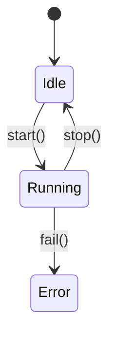

# Visual discipline — diagrams, figures, and ASCII art

Every technical note this skill emits **must** include visual aids wherever a diagram, table, or schematic clarifies more than prose. Diagrams are not ornamental; they are load-bearing when the concept has spatial, temporal, hierarchical, or relational structure. A note on state machines without a state diagram, a note on type hierarchies without a lattice, or a note on execution order without a timeline is incomplete.

## When a diagram is mandatory

Add a diagram whenever the content contains any of:

- **Sequential execution / timeline** — call stack evolution, event loop iterations, message passing between processes. Use a timeline or swimlane diagram.
- **Hierarchies / lattices** — class inheritance, type subsumption, domain decomposition. Use a tree or Hasse diagram.
- **State machines** — lifecycle, protocol, mode transitions. Use a state-transition diagram with labelled edges.
- **Data flow / pipelines** — transformations, ingestion, routing. Use a boxes-and-arrows flow diagram.
- **Layered architectures** — software stacks, memory models, network layers. Use a stacked-boxes diagram.
- **Categorical / algebraic structure** — functors, monads, morphisms. Use a commutative diagram.
- **Comparison across N systems** — feature matrix, correspondence table. Use a table (tables count as visual aids).
- **Memory / storage layout** — heap vs stack, struct layout, tree representations. Use a boxed memory diagram.

## Preferred formats (in order)

1. **ASCII / Unicode box diagrams** directly in the markdown code fences. These render everywhere (Obsidian, GitHub, plain terminal), never break, and survive decades. Default choice.
2. **Mermaid diagrams** inside ```` ```mermaid ```` fences — for flowcharts, sequence diagrams, state diagrams, class diagrams, ER diagrams. Obsidian and GitHub render these natively.
3. **TikZ / LaTeX picture environments** inside math blocks — only for notes that will be formalised in Reflexiones_a_Latex. Mark with `latex_pending: true`.
4. **Markdown tables** — always in play as lightweight structured visual aids.

Do NOT embed binary images (PNG, SVG files) unless the user explicitly asks. They break the self-contained-island property and require vault-side attachments.

## Quality bar

A good diagram:

- Has a **caption** naming what it shows (one line, italicised, below the figure).
- Labels every node, arrow, and region that the prose refers to.
- Is referenced from the surrounding prose at least once (`ver el diagrama N`, `as shown below`).
- Uses consistent symbols across the note (if `→` means "is a subtype of" on page 1, it must mean the same on page 10).
- Fits the ambient category. A state machine diagram for a memory layout is wrong; a memory layout diagram for a state machine is wrong.

A bad diagram is decorative: a flowchart that restates the section headings, an ASCII box around a single word, a commutative diagram whose only arrow is an identity. If a diagram adds no information the prose does not already give, delete it.

## Exemplars — read before drawing

- `06_Knowledge_Base/Computing/python_asyncio.md` §II (event loop algorithm), §IV (stack/heap dynamics), §VI (jerarquía run/create_task/gather) — ASCII box diagrams carrying the operational semantics.
- `06_Knowledge_Base/Computing/type_vs_class_cpp_csharp_python.md` — correspondence tables as primary visual spine.

## ASCII diagram conventions

- Use `┌─┐ │ └─┘` box-drawing characters for boxes. Plain `+---+ | +---+` is acceptable if the ambient text is ASCII-only.
- Arrows: `──▶` for flow, `◀──▶` for bidirectional, `─┬─` for branch, `╱╲` or `/\` for fan-out/fan-in.
- Time flows left-to-right or top-to-bottom — pick one per diagram and stay consistent.
- Align columns with spaces, not tabs. Tabs break rendering width across viewers.

## Mermaid quick reference



```mermaid
sequenceDiagram
    Caller->>Loop: asyncio.run(coro)
    Loop->>Coro: send(None)
    Coro-->>Loop: yield Future
    Loop->>Selector: select()
```

These render in Obsidian with the Mermaid plugin (default) and in GitHub natively.

## The rule

**When in doubt, draw.** The cost of a redundant diagram is small; the cost of a concept the reader cannot spatialise is large. If the concept has shape, show the shape.
