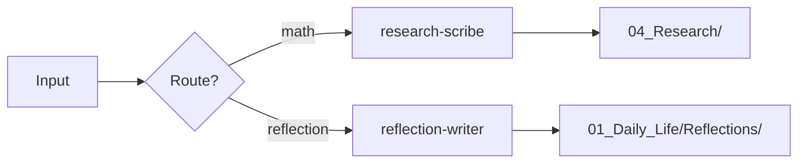
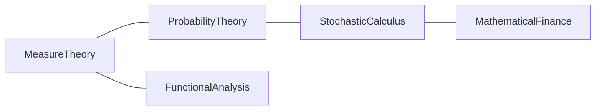
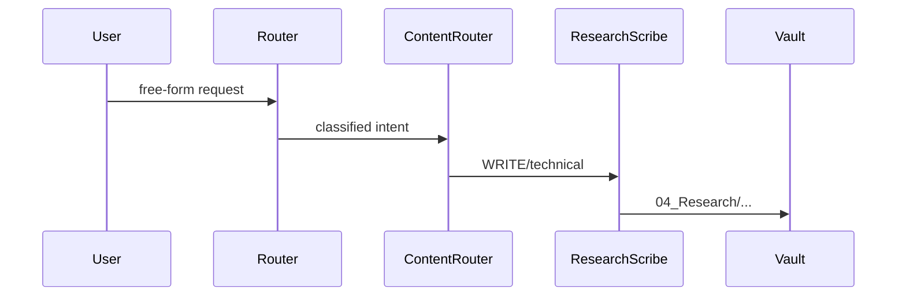
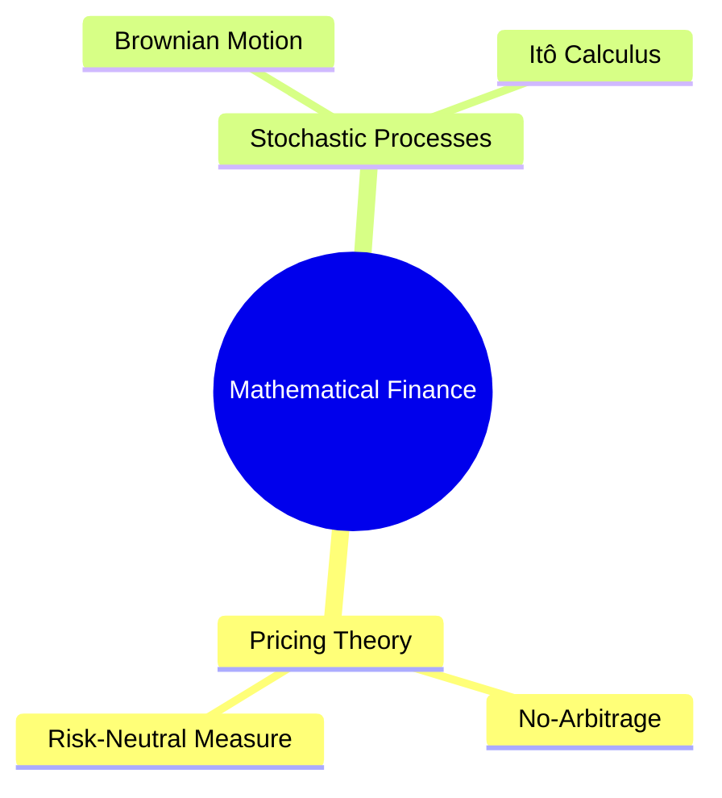
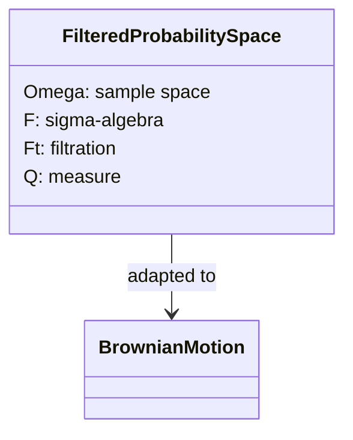
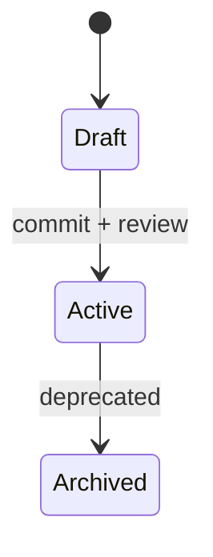

# Markdown Grapher

Use the [common Constellation entry](../../../README.md) for scope, evidence,
independent review and publication. Resolve consultations directly; open a scoped
assignment before a change. Domain names below identify skills or responsibilities;
use the native agent catalogue for delegation, inherit the session settings, and
leave Git integration and publication to the coordinator. Project data paths are
relative to `/Users/omarkhalil/OmarOS` unless an absolute path is given.

## Overview

Responsible for visualisations inside vault markdown files. Uses Mermaid (which Obsidian renders natively), structured tables, ASCII art, and Obsidian callout blocks to create semantically rich visual content embedded in notes.

**Not for TikZ** — for mathematical diagrams destined for LaTeX output, delegate to `latex-tikz-specialist`.

## Quick reference

| Visualisation need | Mermaid type | Direction |
|-------------------|--------------|-----------|
| Pipeline / algorithm flow | flowchart | LR |
| Hierarchy / taxonomy | flowchart | TD |
| Concept relationships | graph | LR |
| Agent interactions, temporal ordering | sequenceDiagram | — |
| Topic overview | mindmap | — |
| Type / structural relationships | classDiagram | — |
| State lifecycle | stateDiagram-v2 | — |
| Cross-domain comparison | markdown table | — |
| Inline ≤4 node diagram | ASCII art | — |

## When this skill runs

- User asks for any visual that will live inside a markdown vault note.
- A writer skill (research-scribe, knowledge-indexer) needs a concept map, process diagram, or comparison table.
- `dashboard-builder` needs a pipeline or status diagram.

Do **not** run for:

- Mathematical diagrams requiring precision or destined for LaTeX → `latex-tikz-specialist`.
- Dataview dashboard queries → `dashboard-builder`.
- Note prose → writer skills.

## Mermaid types

### Flowchart — processes, pipelines, algorithms



Use `LR` for information flow; `TD` for hierarchies.

### Graph — undirected or weakly directed concept relations



### Sequence — interactions and temporal ordering



### Mind map — radial topic explosion



### Class diagram — type / structural relationships



### State diagram — state machines, lifecycle



## Structured tables

For comparison, feature matrix, or cross-domain analogy:

| Concept | Mathematics | Physics | Finance |
|---------|-------------|---------|---------|
| Space of states | Vector space | Phase space / Hilbert space | Sample space Ω |
| Observable | Linear functional | Hermitian operator | Random variable |
| Evolution | ODE / semigroup | Schrödinger eq. | SDE / filtration |
| Symmetry | Group action | Gauge group | No-arbitrage |

Rules: column headers are concepts, not categories. Every cell has a specific item. Use `—` for missing analogues. Max ~6 columns.

## ASCII diagrams

For very simple inline diagrams where a Mermaid block would be disproportionate (≤4 nodes, ≤6 arrows, embedded mid-paragraph):

```
Set X ──f──▶ Set Y
 │                │
 │g               │h
 ▼                ▼
Set Z ──k──▶ Set W
```

## Obsidian callouts

Use for structured knowledge boxes inside notes:

```markdown
> [!definition] Filtration
> A filtration $(\mathcal{F}_t)_{t \geq 0}$ is an increasing family of sub-$\sigma$-algebras...

> [!example] Brownian Filtration
> The natural filtration of Brownian motion...

> [!warning] Coordinate dependence
> The metric tensor $g_{\mu\nu}$ depends on the coordinate chart...
```

Types: `definition`, `theorem`, `example`, `warning`, `info`, `note`, `abstract`, `question`.

## Quality standards

**Correct:** no phantom arrows, no missing edges; type appropriate for the relationship; labels semantically precise.

**Excellent:** layout direction natural for the domain; reveals structure that would require a paragraph in prose; self-explanatory with a one-sentence caption.

## Dependencies

- Sibling skills: `latex-tikz-specialist` (delegate math diagrams destined for LaTeX), `dashboard-builder` (uses this for pipeline diagrams), `research-scribe`, `knowledge-indexer` (call this for concept maps).
