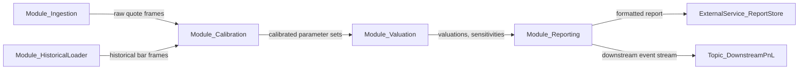

```mermaid
graph LR
  Module_DataLoaders -->|observed time series| Module_ModelCalibration
  Module_ModelCalibration -->|calibrated params, diagnostics| Module_FigureGeneration
  Module_FigureGeneration -->|figure assets| Module_DocumentCorpus
  Module_DocumentCorpus -->|source + figures| Module_Build
  Module_Build -->|rendered document| ExternalService_DocumentStore
```

# Project Isomorph — Worked Examples

Two fully worked examples anchor the style. Both inputs below are **synthetic** — they do not describe any real project. Read them as pedagogical material only.

---

## Example 1 — Small options-pricing pipeline (synthetic)

### BEFORE (what the user has, illustrative)

A project directory containing:

```
acme_pricer/
├── src/
│   ├── ingest/
│   │   ├── bloomberg_client.py      # fetch live quotes via bbg-api
│   │   └── historical_loader.py     # S3 → DataFrame of OHLC bars
│   ├── models/
│   │   ├── bs_vanilla.py            # classic Black–Scholes closed-form
│   │   ├── sabr_surface.py          # SABR volatility surface fitter
│   │   └── monte_carlo_american.py  # Longstaff–Schwartz LSM for Americans
│   ├── calibration/
│   │   ├── market_loader.py         # reads live quotes → ParamSet
│   │   └── lsq_calibrator.py        # Levenberg–Marquardt objective
│   └── reporting/
│       ├── pnl_explain.py           # attribution by risk factor
│       └── report_writer.py         # writes PDF via company template
├── schemas/
│   ├── quote.avro
│   └── valuation.avro
├── config/
│   └── prod_params.yaml             # hardcoded vendor endpoints, API keys ref
└── pyproject.toml
```

Uses: Python 3.11, `numpy`, `pandas`, `scipy`, `bbg-api-client` (vendor SDK), an internal `acme-report-styler` package, AWS S3 for historical data, Bloomberg B-Pipe for live quotes, a PostgreSQL `pricing_results` database, a Kafka topic `pnl.eod.v2` for downstream.

### AFTER (the dossier — excerpt, condensed for illustration)

```markdown
# 1. Project Abstract Overview

- **Purpose**: batch pipeline that ingests observed instrument quotes from a
  market-data vendor and a historical object store, fits a family of
  instrument-valuation models to the observations, produces per-instrument
  valuations and first-order sensitivities, and publishes both a structured
  report and a downstream message stream.
- **System type**: pricing engine.
- **Core architectural paradigm**: batch pipeline-and-filter with a
  calibration loop at its core.

# 2. Global Architecture Graph



Layering: ingestion → calibration → valuation → reporting.

# 3. Folder / Module Structure

## Module_Ingestion

- **Role**: retrieves instrument observations from a live market-data vendor.
- **Dependencies**: internal → (none). External → dependency on a vendor SDK
  for streaming market data.
- **Interfaces exposed**:
  - `fetch_live_observations(universe: list[InstrumentHandle]) -> DataFrame`
- **Invariants**: fetch is stateless; failures raise a typed
  `TransientUpstreamError`; authentication uses `SECRET_HANDLE_VENDOR_AUTH`.

## Module_HistoricalLoader

- **Role**: loads historical time-series bars from an object store.
- **Dependencies**: internal → (none). External → dependency on an
  S3-compatible object-store client.
- **Interfaces exposed**:
  - `load_historical_bars(universe, window: DateRange) -> DataFrame`
- **Invariants**: the returned frame is sorted ascending by
  `col_timestamp`; duplicate `(col_identifier, col_timestamp)` pairs are
  de-duplicated keeping the last-arrived row.

## Module_Calibration

- **Role**: fits model-parameter sets to observed instrument quotes.
- **Dependencies**: internal → Module_Ingestion, Module_HistoricalLoader.
  External → dependency on a numerical-optimisation library.
- **Interfaces exposed**:
  - `calibrate_parameter_set(frames: DataFrame, model_class: ModelClassEnum)
    -> CalibratedParameterSet`
- **Invariants**: calibration is deterministic for a fixed seed; a
  failed convergence raises `CalibrationNonConvergentError` with the
  residual norm attached.

## Module_Valuation

- **Role**: computes instrument valuations and first-order sensitivities
  given a calibrated parameter set.
- **Dependencies**: internal → Module_Calibration.
  External → dependency on a numerical / Monte-Carlo utility library.
- **Interfaces exposed**:
  - `compute_valuations(instruments, params: CalibratedParameterSet,
    method: ValuationMethodEnum) -> DataFrame`
- **Invariants**: valuation is side-effect-free; the
  `ValuationMethodEnum` selects between a closed-form analytic branch and
  a simulation branch.

## Module_Reporting

- **Role**: formats the valuations and publishes them to a report store
  and a downstream event stream.
- **Dependencies**: internal → Module_Valuation.
  External → dependency on a PDF-rendering utility, dependency on a
  message-broker client.
- **Interfaces exposed**:
  - `write_report(valuations: DataFrame, destination: ReportDestination)`
  - `publish_event_stream(valuations: DataFrame, topic: Topic)`
- **Invariants**: a failed report write does not interrupt the event
  publish; both are retried independently with exponential backoff.

# 4. Component Specifications

## ObservationIngestorComponent

- **Type**: class.
- **Runtime**: `Runtime_InterpretedDynamic`.
- **Input Signature**:
  - Types: `list[InstrumentHandle]`, `SECRET_HANDLE_VENDOR_AUTH`
  - Shape: list of N instrument handles; N in the O(10³)–O(10⁴) class
  - Constraints: handle strings must pass a vendor-format regex
- **Output Signature**:
  - Types: `DataFrame`
  - Shape: `DataFrame[N × K]` where K = {col_timestamp, col_identifier,
    col_bid, col_ask, col_volume_bucket}
  - Determinism / stochasticity: deterministic given the upstream
    vendor's state at fetch time.
- **Internal Logic**:
  - Opens a streaming session to the vendor.
  - Issues a subscribe request for the input universe.
  - Collects responses until a per-request quiescence window elapses.
  - Transforms the vendor-native message shape into the internal frame schema.
- **Side Effects**: emits metrics to an observability pipeline; logs per-request
  latency and failure counts; no DB or file writes.

## ClosedFormValuationComponent

- **Type**: pure function.
- **Runtime**: `Runtime_InterpretedDynamic`.
- **Input Signature**:
  - Types: `DataFrame`, `CalibratedParameterSet`
  - Shape: `DataFrame[N × K]`, `CalibratedParameterSet` with P free parameters
    (P = small constant, class O(10))
  - Constraints: the parameter set must have been produced by a calibration
    matching the same model class.
- **Output Signature**:
  - Types: `DataFrame`
  - Shape: `DataFrame[N × V]` where V = {col_identifier,
    col_present_value, col_first_order_sensitivity_<k>}
  - Determinism: deterministic.
- **Internal Logic**:
  - Applies a closed-form valuation formula under a log-normal asset-price model.
  - Computes first-order sensitivities by analytical differentiation under the same model.
- **Side Effects**: none.

## SimulationValuationComponent

- **Type**: stateful function.
- **Runtime**: `Runtime_InterpretedDynamic`.
- **Input Signature**:
  - Types: `DataFrame`, `CalibratedParameterSet`, `SimulationConfig`
  - Shape: `DataFrame[N × K]`, config carrying a seed and a path-count
    `M` (M ~ O(10⁴)–O(10⁶))
  - Constraints: seed is mandatory for reproducibility.
- **Output Signature**:
  - Types: `DataFrame`
  - Shape: `DataFrame[N × V]` same columns as closed-form, plus
    `col_standard_error`
  - Determinism: deterministic given (input, seed).
- **Internal Logic**:
  - Draws M paths from the calibrated process.
  - Applies an early-exercise heuristic fitted over the paths (Monte-Carlo
    valuation of early-exercisable payoffs by regression on in-the-money paths).
  - Aggregates by instrument and computes a standard-error estimate.
- **Side Effects**: consumes a CPU pool; logs progress metrics.

# 5. Data Structures & Schemas

## Dataset_RawObservations

- **Storage class**: in-memory DataFrame (transient), plus a durable
  columnar store for the intraday historical path.
- **Structure**:
  - Columns:
    - `col_timestamp`: datetime, not null — event time of the observation.
    - `col_identifier`: string, not null — opaque handle of the observed instrument.
    - `col_bid`, `col_ask`: float, not null — numeric observations.
    - `col_volume_bucket`: enum-of-4-values, not null.
  - Relationships: primary key `(col_identifier, col_timestamp)`.
- **Constraints**:
  - Uniqueness on `(col_identifier, col_timestamp)`.
  - `col_timestamp` strictly increasing within a fixed `col_identifier`.
  - Append-only (no updates).
- **Cardinality**: `O(10⁶)` rows per batch, `5` columns.

## Dataset_CalibratedParameters

- **Storage class**: in-memory record, persisted as a serialized blob.
- **Structure**:
  - Columns:
    - `col_calibration_timestamp`: datetime, not null.
    - `col_model_class`: enum-of-4-values, not null.
    - `col_parameters`: structured record (O(10) fields).
    - `col_residual_norm`: float, not null.
    - `col_seed`: int, not null.
  - Relationships: one calibration per (`col_model_class`, `col_calibration_timestamp`).
- **Constraints**:
  - `col_residual_norm` must be below a threshold τ for the calibration to be usable.
- **Cardinality**: O(1) records per daily batch.

# 6. Execution Flow

1. **Initialization**
   - Inputs: startup config (credential handles, universe definition), a connection pool to `Database_OperationalStore`.
   - Transformations: schema checks on config, bootstrap of connection pool, registration of metric emitters.
   - Outputs: a ready `ValuationOrchestratorService`.

2. **Data ingestion**
   - Inputs: the instrument universe, `ExternalService_MarketDataVendor` live session, `Database_OperationalStore` historical partition.
   - Transformations: fetch live observations, load historical bars, merge on `(col_identifier, col_timestamp)`, drop duplicates.
   - Outputs: a `Dataset_RawObservations` frame.

3. **Processing — calibration**
   - Inputs: `Dataset_RawObservations`, a selected `ModelClassEnum`.
   - Transformations: objective construction, numerical optimisation, residual diagnostics.
   - Outputs: a `Dataset_CalibratedParameters` record.

4. **Processing — valuation**
   - Inputs: the universe, the freshly calibrated parameters.
   - Transformations: dispatch to either closed-form or simulation branch, compute first-order sensitivities.
   - Outputs: a `Dataset_DerivedValuations` frame.

5. **Output generation**
   - Inputs: `Dataset_DerivedValuations`.
   - Transformations: format a structured report, serialize an event stream payload.
   - Outputs: a rendered document posted to `ExternalService_ReportStore`; a sequence of messages on `Topic_DownstreamPnL`.

# 7. Integration Points

## ExternalService_MarketDataVendor

- **Kind**: REST API + persistent streaming session.
- **Direction**: read.
- **Protocol**: HTTP/1.1 for auth, a proprietary bidirectional streaming channel for data.
- **Payload shape**: vendor-native observation records; adapted internally to `Schema_ObservationPayload_v1`.
- **Auth model**: vendor-specific key rotated daily; key material lives in `SECRET_HANDLE_VENDOR_AUTH`.
- **Rate / SLA**: `O(10³)` requests per day; vendor-side SLA of 99.5%.
- **Failure mode to tolerate**: transient 5xx bursts, occasional schema drift on fringe instruments.

## Database_OperationalStore

- **Kind**: relational database.
- **Direction**: read/write.
- **Protocol**: SQL over TCP.
- **Payload shape**: `Schema_ObservationPayload_v1` on read; `Schema_ValuationResult_v1` on write.
- **Auth model**: IAM-scoped credentials injected at boot; no long-lived password.
- **Rate / SLA**: `O(10⁵)` writes per day; in-shop SLA.
- **Failure mode to tolerate**: connection-pool exhaustion under spike load.

## Topic_DownstreamPnL

- **Kind**: message broker topic.
- **Direction**: write.
- **Protocol**: publish/subscribe broker.
- **Payload shape**: `Schema_ValuationResult_v1`.
- **Auth model**: mutual TLS.
- **Rate / SLA**: `O(10⁴)` messages per day.
- **Failure mode to tolerate**: broker rebalance causing a brief publish stall.

# 8. Reconstructability Notes

- **Required components to rebuild**:
  - `ObservationIngestorComponent` (adapter shape + internal frame schema).
  - `HistoricalLoaderComponent`.
  - `CalibrationOrchestratorService` with at least one model class wired through.
  - At least one of `ClosedFormValuationComponent` or `SimulationValuationComponent`
    (both if full parity is desired).
  - `ReportRendererComponent` (the specific rendering back-end can be freely chosen).
  - `EventPublisherComponent`.
- **Expected behaviours**:
  - Given the same `(Dataset_RawObservations, ModelClassEnum, seed)`, a second
    invocation produces byte-identical `Dataset_CalibratedParameters` and, in the
    closed-form branch, byte-identical `Dataset_DerivedValuations`.
  - End-to-end latency for a single batch of `O(10³)` instruments is measured in
    minutes, not hours.
  - A transient vendor outage of up to one hour is tolerated with retries; a
    longer outage fails the batch cleanly and leaves no partial writes.
- **Key assumptions**:
  - Input universe cardinality stays in `O(10³)–O(10⁴)` instruments.
  - Historical store partitioning is consistent with ingestion windowing.
  - The calibration objective is convex *on the relevant subdomain* for the
    model classes in use.
- **Known non-preservation**:
  - Specific calibration tuning (regularisation weight, initial guesses,
    optimiser tolerances) is not preserved — downstream AI must re-tune.
  - Vendor-specific quirks of the observation payload are not preserved — the
    adapter must be re-written against the chosen vendor.
  - Exact thresholding for the early-exercise heuristic is abstracted.
- **Suggested rebuilding order**: start with `Dataset_*` schemas (Section 5),
  then mock `ExternalService_MarketDataVendor` with a synthetic feed, build
  `Module_Calibration` against that, then `ClosedFormValuationComponent` for a
  first working end-to-end, then add `SimulationValuationComponent` and
  `Module_Reporting`.
```

### Commentary on Example 1

Notice what survived (cardinalities, module count, interface shapes, algorithmic classes, data schemas by role) and what was stripped (vendor names, class names, file names, the actual formulas, numerical tuning, error strings). A reader can tell this is an options-pricing pipeline. A reader cannot tell which firm wrote it, which vendor it uses, or what the actual calibration trick is.

---

## Example 2 — Research / LaTeX / data-heavy project (synthetic)

### BEFORE (illustrative)

```
Reflexiones_a_Latex_work/
├── corpus/
│   ├── chapters/
│   │   ├── ch01_convergencia_martingalas.tex
│   │   ├── ch02_calibracion_hjm.tex
│   │   └── ch03_power_markets_storengy.tex
│   ├── figures/
│   └── refs.bib
├── code/
│   ├── notebooks/
│   │   └── hjm_calibration_eod_june.ipynb
│   ├── scripts/
│   │   └── fit_ou_process_to_spot.py
│   └── data_loaders/
│       └── storengy_spot_loader.py
└── build/
    └── latexmk.config
```

### AFTER (excerpt)

```markdown
# 1. Project Abstract Overview

- **Purpose**: research project that interleaves a long-form theoretical
  document (a mathematical monograph) with a cluster of analysis scripts
  and notebooks that calibrate stochastic process models to observed
  market data and produce figures that feed back into the monograph.
- **System type**: research notebook cluster with a document-generation pipeline.
- **Core architectural paradigm**: dataflow — data ingestion feeds model
  calibration, calibration produces diagnostics, diagnostics are rendered
  as figures, figures are included in a LaTeX document that is compiled to PDF.

# 2. Global Architecture Graph



# 3. Folder / Module Structure

## Module_DocumentCorpus

- **Role**: holds the long-form monograph, organised as chapters, with a shared bibliography and a figure directory.
- **Dependencies**: internal → Module_FigureGeneration (figures are rendered elsewhere and copied in). External → LaTeX toolchain.
- **Interfaces exposed**: chapter files (`Chapter_<ThemeRole>.tex`), a shared `Bibliography` file.
- **Invariants**: figures referenced in chapters must exist in the figures directory; compilation is idempotent.

## Module_DataLoaders

- **Role**: provides adapters from external observation sources to an internal time-series frame.
- **Dependencies**: internal → (none). External → dependency on an HTTP client and on a DataFrame library.
- **Interfaces exposed**: `load_observations(source: SourceEnum, window: DateRange) -> DataFrame`.
- **Invariants**: returns a monotonic time-series; caches on a role-identified cache directory.

## Module_ModelCalibration

- **Role**: fits stochastic process models to observed series.
- **Dependencies**: internal → Module_DataLoaders. External → numerical-optimisation library.
- **Interfaces exposed**: `calibrate(series, model_class) -> CalibratedProcessParameters`.
- **Invariants**: calibration seeded and deterministic; residual diagnostics emitted alongside parameters.

(… Module_FigureGeneration and Module_Build follow the same shape — omitted for brevity …)

# 8. Reconstructability Notes (excerpt)

- **Required components to rebuild**: the document corpus, a data adapter layer, at least one model class end-to-end (e.g. one Ornstein–Uhlenbeck-style mean-reverting process), a figure generator, a LaTeX build step.
- **Expected behaviours**: a full build produces a rendered document with figures regenerated from source data; rebuilding with the same seeded calibration inputs produces byte-identical figures.
- **Known non-preservation**: chapter text (of course — the prose is the sensitive part and is not reproducible from the dossier), exact calibration tuning, the specific observed series.
- **Suggested rebuilding order**: stand up `Module_DataLoaders` with a synthetic series first, then `Module_ModelCalibration` for one model class, then `Module_FigureGeneration`, then the skeleton of `Module_DocumentCorpus` with placeholder chapter text.
```

### Commentary on Example 2

The dossier preserves that this is a research project with a specific shape (monograph + calibration scripts + figure pipeline) and that the calibration is of stochastic processes to time series. It erases the actual theme of the monograph (chapter titles), the specific data source, the specific calibration tricks, and the specific models. A downstream AI could stand up a shell with the same shape without ever knowing the subject matter.

---

## How to use these examples while producing a new dossier

- Match the **level of specificity** demonstrated here: enough type and shape information that a downstream AI can implement, little enough content detail that a competitor could not reverse the business from it.
- Match the **tone**: crisp, no storytelling, numbered headings, bulleted fields, generous use of `<placeholder>` tokens.
- Match the **section budget**: Section 1 is short, Section 4 is the largest (one sub-block per component), Section 8 is consequential.
- Avoid the temptation to paste code. When you feel a pseudocode block would help, first ask: would a type signature or a prose description convey the same information? Usually yes.
