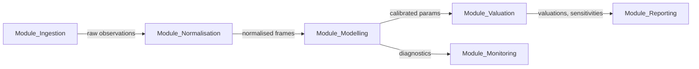

# Project Isomorph — Output Template (authoritative)

This is the exact structure every dossier must follow. The skill's contract is that the output is machine-parseable by another AI, so the headings, field names, and ordering here are load-bearing. Deviate only when the underlying project genuinely lacks a section (e.g. a pure-compute script with no external integration points) — and even then, emit the heading with an explicit `_not applicable to this project_` body rather than omitting.

---

## Top-level skeleton

```markdown
# 1. Project Abstract Overview
# 2. Global Architecture Graph
# 3. Folder / Module Structure
# 4. Component Specifications
# 5. Data Structures & Schemas
# 6. Execution Flow
# 7. Integration Points
# 8. Reconstructability Notes
```

Each section's required shape is below.

---

## 1. Project Abstract Overview

Three bulleted fields. Keep each to a single paragraph or tight bullet list.

- **Purpose** — what the system does, abstractly. Example: "batch pipeline that ingests market microstructure data, calibrates a multi-factor pricing model against observed quotes, and publishes daily mark-to-market valuations and risk sensitivities". Avoid the real business domain; keep it one level up.
- **System type** — one of: `data pipeline`, `pricing engine`, `numerical solver`, `UI system`, `async API client`, `batch reporting system`, `event-driven service`, `research notebook cluster`, `static-site generator`, `ML training pipeline`, `ML inference service`, `monitoring/observability layer`, `workflow orchestrator`, `ETL job`, etc. Choose the most specific category that still applies after redaction.
- **Core architectural paradigm** — one of: `event-driven`, `batch`, `reactive`, `PDE solver`, `Monte Carlo simulation`, `graph-traversal`, `MapReduce-style`, `request/response`, `publish/subscribe`, `CQRS`, `actor model`, `dataflow`, `pipeline-and-filter`. More than one is allowed if legitimately hybrid.

---

## 2. Global Architecture Graph

Express the system as a directed graph. Two required parts:

### 2.a Nodes and edges

A markdown table or Mermaid diagram (prefer Mermaid for legibility) listing:
- every top-level module as a node
- directed edges = data/control flow, with an edge label indicating what flows (`"calibrated params"`, `"raw observations"`, `"event stream"`)
- optional layering annotation (`[layer: ingestion]`, `[layer: transformation]`, `[layer: output]`)

Example shape (do not reuse the specific names — these are illustrative):

````markdown

````

### 2.b Layering (optional but recommended)

If the system cleanly stratifies, list the layers in order (ingestion → transformation → modelling → output). For each layer, name the modules that belong to it.

---

## 3. Folder / Module Structure

For each top-level folder/module in the project, emit one subsection with exactly this shape:

```markdown
## Module_<Role>

- **Role**: one-sentence description of what this module is responsible for, abstractly.
- **Dependencies**:
  - Internal: `Module_<Role1>`, `Module_<Role2>`
  - External: `dependency on an HTTP client`, `dependency on a DataFrame library`, `dependency on a numerical linear algebra library`
- **Interfaces exposed**: bulleted list of entry points other modules / external callers use (function signatures, class constructors, CLI entry points, HTTP handlers — name them generically).
- **Invariants**: properties that must hold for this module to be correct. Examples: "idempotent on re-run", "pure function — no I/O", "never mutates inputs", "output ordering preserved from input", "write-behind caching — consistency is eventual".
```

The number of subsections here must equal the number of real top-level modules. Do not collapse or merge.

---

## 4. Component Specifications

For each non-trivial component (class, function, service, script) in each module, emit one subsection. Err on the side of including more components when in doubt — reconstructability depends on this.

```markdown
## <RolePlaceholder>Component

- **Type**: one of `class`, `pure function`, `stateful function`, `script`, `service`, `daemon`, `worker`, `middleware`, `decorator`, `context manager`, `coroutine`, `generator`.
- **Runtime**: abstract execution platform — `Runtime_InterpretedDynamic`, `Runtime_CompiledStatic`, `Runtime_Managed`, `Runtime_Browser`, `Runtime_Container`. Only name the specific language if it is NOT business-identifying.
- **Input Signature**:
  - **Types**: (e.g. `list[Record]`, `DataFrame[n_rows, n_columns]`, `dict[str, Real]`, `Stream[Event]`)
  - **Shape**: (e.g. `DataFrame[N, 12]` where `N` is batch size; `tensor[B, C, H, W]`)
  - **Constraints**: (e.g. "timestamps strictly increasing", "non-null keys", "values in [0, 1]", "schema matches Dataset_RawInputs")
- **Output Signature**:
  - **Types**: same shape convention
  - **Shape**: same shape convention
  - **Determinism / stochasticity**: one of `deterministic`, `stochastic with seed`, `stochastic unseeded`, `time-dependent`.
- **Internal Logic (abstracted)**: 1–5 bullets describing the transformations. Algorithm **class** only — never parameters, never formulas. Acceptable: "applies a closed-form solution for the heat equation on a uniform grid"; "performs a stochastic gradient descent over an MSE objective"; "runs a Kalman filter update over observed residuals"; "aggregates input records by a grouping key and computes summary statistics". Not acceptable: the actual formula, the actual tuning constants, the actual gradient, the actual rules.
- **Side Effects**: any I/O, cache writes, logging, network calls, DB writes, file writes, metric emissions. Name the type, not the target (`writes to Database_OperationalStore`, not `writes to prod-orders-v2`).
```

The count of components across the dossier must match the count in the real project (to the granularity the user expects — it's fine to skip one-line helper functions and trivial wrappers, but every class and every meaningful function must appear).

---

## 5. Data Structures & Schemas

For each dataset, table, message schema, in-memory structure, or file format, emit one subsection:

```markdown
## Dataset_<Role>

- **Storage class**: one of `relational table`, `columnar store`, `document store`, `key-value store`, `time-series store`, `flat file (delimited)`, `flat file (binary)`, `in-memory DataFrame`, `message payload`, `cache entry`.
- **Structure**:
  - **Columns** (or fields):
    - `col_<role>`: type, nullability, brief description of the field's semantic role — NEVER the real column name. Example: `col_timestamp: datetime, not null — event time of the observation`.
  - **Relationships**: primary key, foreign keys (to other Dataset_<Role> entries in this dossier), indices.
- **Constraints**:
  - **Uniqueness**: e.g. "unique on (`col_identifier`, `col_timestamp`)"
  - **Nullability**: e.g. "`col_numeric_measure` nullable when `col_status = 'pending'`"
  - **Temporal consistency**: e.g. "rows are append-only", "effective-dating via (`col_valid_from`, `col_valid_to`)"
- **Cardinality**: rough order of magnitude (`O(N)` rows per day where `N ~ 10^5`, `O(M)` columns where `M ~ 20`) — preserve the class, not the actual number.
```

Columns are renamed using role-semantic placeholders (`col_timestamp`, `col_identifier`, `col_numeric_measure`, `col_category`, `col_status_flag`, `col_free_text`, `col_enum_<k>_values`). Never keep the real column name — that is a classic leak vector.

---

## 6. Execution Flow

A numbered walk-through of the pipeline end-to-end. Use this exact scaffold; skip a step only if genuinely not applicable.

```markdown
1. **Initialization**
   - Inputs: (what is present before the pipeline starts — config, credentials handles, cached state)
   - Transformations: (setup, schema validation, connection pool creation)
   - Outputs: (an initialised system ready to consume events/batches)

2. **Data ingestion**
   - Inputs: (which datasets / streams / APIs supply the raw material — reference Dataset_<Role> / ExternalService_<Role> names from earlier sections)
   - Transformations: (read, parse, validate, de-duplicate, enrich)
   - Outputs: (what normalised form the rest of the pipeline sees)

3. **Processing stages**
   - For each major transformation stage, repeat the (Inputs → Transformations → Outputs) triplet. Reference the components and datasets by their generic names.

4. **Output generation**
   - Inputs: (the final intermediate form)
   - Transformations: (formatting, aggregation, persistence)
   - Outputs: (the system's deliverables — reports, API responses, DB writes, file drops)
```

This section is what lets a downstream AI understand not just *what* the pieces are but *how they compose*. Spend time on it.

---

## 7. Integration Points

For each external system the project talks to, list:

```markdown
## ExternalService_<Role>

- **Kind**: `REST API`, `gRPC service`, `message broker`, `database`, `SFTP drop`, `file share`, `object store`, `SaaS console`.
- **Direction**: `read`, `write`, `read/write`.
- **Protocol**: `HTTP/1.1`, `HTTP/2`, `WebSocket`, `AMQP`, `Kafka`, `SQL-over-TCP`, `S3-compatible`, etc.
- **Payload shape**: reference a Dataset_<Role> schema from Section 5, or describe the shape inline if it's transient.
- **Auth model**: `API key`, `OAuth 2 client credentials`, `mutual TLS`, `IAM role`, `VPN-gated`. Never the actual credential value or handle name.
- **Rate / SLA**: order-of-magnitude only (`O(10^3) req/day`, `O(10^5) messages/min`).
- **Failure mode the system must tolerate**: e.g. "transient 503 bursts", "occasional schema drift", "24h outages possible during vendor maintenance".
```

If the project has no external integrations, emit the section heading with body `_none — self-contained system_`.

---

## 8. Reconstructability Notes

This is the most important section. It is the contract between the dossier and the downstream AI rebuilding the system. Cover:

```markdown
- **Required components to rebuild**: enumerate (with reference to Section 4 names) every component a minimum viable reconstruction must include. Note which components are core vs. optional observability / convenience.
- **Expected behaviours**: bullet list of end-to-end properties the rebuilt system must exhibit. Examples: "given two identical input batches, produce byte-identical outputs", "latency from ingestion to final output under X seconds at the system's cardinality class", "tolerates one external-service outage without data loss".
- **Key assumptions**:
  - About inputs: shape, rate, sparsity, noise level.
  - About environment: compute class (CPU-bound / IO-bound / GPU-required), memory ceiling, persistence guarantees.
  - About external services: their SLAs, their payload shapes, the auth model.
- **Known non-preservation** (honest disclosure of what the dossier cannot capture): e.g. "specific numerical tuning of the calibration step is not preserved — downstream AI must re-tune on its own data", "proprietary heuristics in the scoring function are abstracted to their class (monotonic scoring under a bounded objective) — exact weights must be relearned".
- **Suggested rebuilding order**: a proposed order of work for a downstream AI (e.g. "stand up Dataset_RawInputs schema first; implement Module_Ingestion against a mocked ExternalService_Vendor; then Module_Modelling against synthetic calibrated inputs; then wire end-to-end").
```

---

## Style checklist (apply before returning)

- [ ] All 8 top-level headings present, in order, spelled exactly as above.
- [ ] No literal code copied from the source.
- [ ] No real class names, function names, file names, column names, endpoint names, env-var names, or business-domain terms.
- [ ] Every component in Section 4 has a full Input Signature AND Output Signature.
- [ ] Every module in Section 3 lists internal + external dependencies and at least one invariant.
- [ ] Section 8 (reconstructability notes) is not empty and names specific expected behaviours.
- [ ] Numerical tuning, error strings, log messages, comments, file paths all redacted.
- [ ] Count of modules, components, and datasets matches the real project's cardinality.
